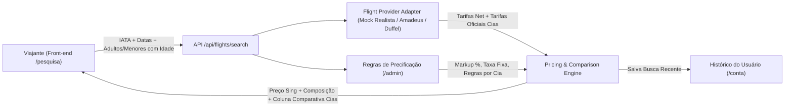

# Arquitetura Técnica e Motor de Precificação — Sing Viagens SaaS

> **Regra de Governança:** Toda alteração sistêmica no código deve ser refletida nesta documentação oficial e registrada no `04-CHANGELOG.md`.

---

## 1. Stack Tecnológica
- **Framework Full-Stack**: **Next.js (App Router + TypeScript)**
  - Renderização híbrida (SSR/SSG) para SEO máximo nas páginas de conversão, Landing Pages de Serviços e Blog.
  - Rotas de API (`src/app/api/...`) integradas para busca de voos, cálculo de markup, autenticação e persistência de histórico.
- **Estilização**: **Tailwind CSS** configurado com os tokens oficiais da Sing (`#172C3B`, `#BD9472`, `#E8E2D9`).
- **Camada de Dados & Persistência**:
  - Armazenamento estruturado local em JSON/SQLite com camada de repositório tipada (`src/lib/db.ts`), permitindo funcionamento imediato zero-config no ambiente Windows e migração transparente para PostgreSQL/Prisma em produção.

---

## 2. Arquitetura do Motor de Busca de Passagens e Comparativo



### 2.1. Regras de Passageiros (Nomenclatura 100% em Português)
- **Adultos (12 anos ou mais)**: 100% da tarifa/milhas base aplicável.
- **Crianças / Menores (2 a 11 anos)**: Desconto parametrizável (padrão 25% sobre a tarifa base, mantendo 100% da taxa de embarque).
- **Bebês de colo (0 a 1 ano)**: Tarifa reduzida (padrão 85% de desconto sobre a tarifa base, isento de assento próprio).
- Toda a interface exibe os rótulos por extenso em português (**"Adulto / Adultos"**, **"Criança / Crianças"** e **"Bebê de colo"**), sem abreviações técnicas em inglês (`ADT`/`CHD`).

### 2.2. Fórmula Oficial de Composição de Preço Sing (Custo de Milheiro vs. Preço na Cia Aérea)
Na pesquisa realizada via API, o sistema recebe tanto o **preço em milhas** quanto o **valor comercial direto na Companhia Aérea** (com taxas). O cálculo parametrizado no Painel Admin (`/admin`) segue exatamente a regra de negócio da Sing:

1. **Custo em Milhas com Taxas (`Custo_Milhas_Total`)**:
   - Cada companhia aérea possui seu **Valor de Compra por Milheiro (`R$ / 1.000 milhas`)** configurado no `/admin` (ex.: LATAM `R$ 24,50`, GOL `R$ 17,50`, Azul `R$ 21,00`, TAP `R$ 42,00`, American `R$ 68,00`).
   - `Custo_Puro_Milhas = (Milhas_Totais_Voo / 1000) * Valor_Milheiro_Cia`
   - `Custo_Milhas_Total = Custo_Puro_Milhas + Taxas_Embarque`
2. **Diferença / Spread frente à Companhia Aérea (`Diferenca_Bruta`)**:
   - `Diferenca_Bruta = Preco_Direto_Cia_Com_Taxas - Custo_Milhas_Total`
3. **Margem de Lucro Parametrizada sobre a Diferença (`Lucro_Sing`)**:
   - O administrador define no `/admin` qual será a **Margem de Lucro em `%` entre o Custo por Milhas e o Valor da Cia** (`profitShareOnSavingsPercent`, padrão `50%`).
   - `Lucro_Sing = Diferenca_Bruta * (Margem_Spread_Percent / 100)`
   - `Preco_Final_Sing = Custo_Milhas_Total + Lucro_Sing`
   - **Exemplo Prático Oficial**:
     - Custo da passagem em milhas (já com taxas): **R$ 1.000,00**
     - Preço da mesma passagem direto na Companhia Aérea: **R$ 1.500,00**
     - Diferença entre Cia e Custo em Milhas: **R$ 500,00**
     - Margem parametrizada no Admin: **50% da diferença** (`R$ 250,00` de lucro Sing e `R$ 250,00` de economia líquida para o cliente)
     - **Preço Final de Venda Sing**: **R$ 1.250,00**

---

## 3. Estrutura de Diretórios do Projeto
- `/docs`: Documentação oficial viva do sistema SaaS.
- `/public`: Ativos estáticos, incluindo `/public/logo.png` (logotipo oficial enviado).
- `/src/data`: Base de aeroportos internacionais (IATA), artigos do blog, serviços, portfólio, FAQs e banco de dados persistente (`db.json`).
- `/src/lib`: Motor de precificação, adaptador de pesquisa de voos e gerenciamento de sessão/histórico.
- `/src/components`: Cabeçalho responsivo (com logo e versão simplificada), Rodapé completo, Buscador IATA com seletor de passageiros/idades e tabelas comparativas.
- `/src/app`: Todas as rotas públicas, área do cliente (`/conta`, `/login`) e painel administrativo (`/admin`).
- `Dockerfile` & `docker-compose.yml`: Infraestrutura containerizada pronta para desenvolvimento e produção.

---

## 4. Infraestrutura Docker e Orquestração (`Docker Compose`)

O sistema conta com containerização completa para garantir paridade entre desenvolvimento local e deploy em nuvem (VPS, AWS ECS, Google Cloud Run, DigitalOcean, Coolify ou Portainer):

1. **Container da Aplicação (`singviagens-app` — `Dockerfile`)**:
   - Baseado em `node:22-alpine` com **multi-stage build** (`deps` → `builder` → `runner`).
   - Utiliza o modo `output: "standalone"` do Next.js para gerar uma imagem enxuta, segura (executando sob usuário não-root `nextjs`) e de inicialização instantânea na porta `3000`.
   - Volume mapeado em `./src/data:/app/src/data` para persistir as parametrizações de markup do Admin e o histórico de pesquisas/compras mesmo ao recriar containers.
2. **Container de Banco de Dados (`singviagens-postgres`)**:
   - Baseado em `postgres:16-alpine`, mapeado na porta `5435` do host (`5435:5432` para evitar conflito com instâncias PostgreSQL locais na `5432`) com volume nomeado `singviagens_pgdata` e *healthcheck* automático (`pg_isready`).
3. **Comandos Oficiais de Operação Docker**:
   - Subir apenas o banco PostgreSQL em background (enquanto desenvolve localmente com `npm run dev`):
     ```powershell
     docker compose up -d sing-db
     ```
   - Subir toda a stack (Aplicação Next.js Standalone + PostgreSQL):
     ```powershell
     docker compose up -d --build
     ```
   - Verificar status e logs:
     ```powershell
     docker compose ps
     docker compose logs -f sing-web
     ```

