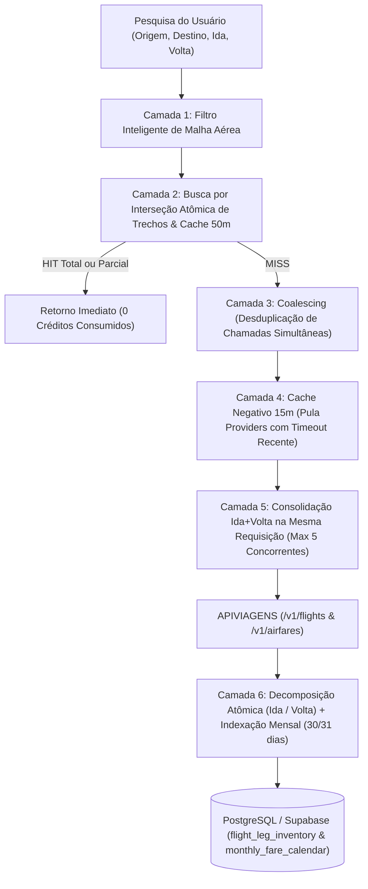

# Gateway de Otimização de Custos APIVIAGENS & Indexação por Interseção Mensal

> **Documento Técnico Oficial — Sing Viagens e Turismo (SaaS)**  
> **Escopo:** Minimização de consumo de créditos na API paga (`https://api.apiviagens.com.br`), aproveitamento de regras de tarifação, decomposição atômica de trechos e armazenamento mensal com busca por interseção no PostgreSQL/Supabase.

---

## 1. Diagnóstico e Regras de Tarifação da APIVIAGENS

A validação real contra os endpoints `GET /v1/account` e `GET /v1/flights` estabeleceu os seguintes parâmetros operacionais da conta:

```json
{
  "account": "Donaldson Araujo Nunes",
  "balance_credits": 1000,
  "credits_per_search": 25,
  "max_concurrent": 5,
  "reserved_credits": 0
}
```

### Regras Críticas do Provedor:
1. **Cobrança por Resultado (`credits_per_search: 25` = `R$ 0,25`)**:
   - Cada crédito equivale a **`R$ 0,01`** (`1.000 créditos = R$ 10,00`).
   - Cada chamada a um `provider` (`smiles`, `azul`, `aadvantage`, `latam`, `tarifado`, `tap`, `azulpelomundo`) que **retorna voos (`Com resultado` / `Cobrada`)** consome **25 créditos (`-R$ 0,25`)**.
   - Chamadas que retornam **`Sem resultado`** ou **`status: "timeout"`** consomem **0 créditos (`R$ 0,00`)** (confirmado via `/v1/account` e painel de logs da APIVIAGENS).
   - As telas internas de "Busca de voo" e "Busca de hotéis" dentro do painel `painel.apiviagens.com.br` também descontam do saldo ("Consulta real, cobrada do seu saldo, para conferir a integração").
2. **Reserva e Consulta de Localizador Gratuitas (`0 créditos`)**:
   - O `offer_id` retornado na busca tem validade de **~1 hora**.
   - Efetuar a reserva (`POST /v1/airfares/book`) dentro dessa janela de ~1h é **100% gratuito**.
   - Consultar o status do localizador (`GET /v1/airfares/booking/{locator}`) e o saldo (`GET /v1/account`) também é **100% gratuito**.
3. **Limite de Concorrência (`max_concurrent: 5`)**:
   - Disparar mais de 5 requisições simultâneas causa bloqueio/erro de concorrência.

---

## 2. As 6 Camadas de Economia Implementadas (`src/lib/apiViagensService.ts`)



### Camada 1 — Roteador Inteligente de Providers por Malha Aérea (`selectOptimalProvidersForRoute`)
Bloqueia automaticamente chamadas para programas que não operam a rota pesquisada:
- **Rotas Domésticas Brasil (`GRU -> REC`, `CGH -> SDU`, etc.)**:
  - Consulta apenas: `tarifado`, `latam`, `smiles` (e `azul` no modo elegível).
  - **Bloqueia automaticamente**: `tap`, `aadvantage` e `azulpelomundo` — **economia imediata de 75 a 100 créditos por busca**.
- **Modos de Consumo Selecionáveis na UI (`FlightSearchExperience.tsx`)**:
  - `CASH_FIRST`: Consulta apenas `tarifado` (25 créditos) na largada; milhas apenas sob demanda.
  - `SMART_ECONOMY` (Padrão): Consulta `tarifado` + Top 2 programas da rota.
  - `ALL_ELIGIBLE`: Consulta todos os programas compatíveis com a região geográfica (limitado a `max_concurrent: 5`).

### Camada 2 — Cache Ativo de 50 Minutos com Preservação de `offer_id`
- Como o `offer_id` expira em ~60 minutos na APIVIAGENS, o cache mantém a oferta viva por **50 minutos (`OFFER_CACHE_TTL_MS`)**.
- Durante 50 minutos, qualquer repetição da busca ou avanço para o Checkout (`/checkout` -> `POST /v1/airfares/book`) reutiliza o `offer_id` em cache com **custo zero**.

### Camada 3 — Desduplicação de Requisições em Voo (`inFlightRequests`)
- Se dois cliques ou dois usuários dispararem a mesma rota simultaneamente, apenas 1 chamada vai à APIVIAGENS e ambas aguardam a mesma `Promise`.

### Camada 4 — Cache Negativo de 15 Minutos (`negativeProviderCache`)
- Quando um *provider* (ex.: `smiles`) retorna `Sem resultado` ou `status: "timeout"`, a APIVIAGENS não cobra créditos, mas a chamada leva ~12–15s até expirar e ocupa 1 slot de `max_concurrent`.
- O Cache Negativo memoriza por **15 minutos** que aquele *provider* está sem retorno naquela rota/data, evitando travar as próximas pesquisas.

### Camada 5 — Consolidação de Ida e Volta + Trava `allowLiveCreditSpend`
- Ida e volta são sempre enviadas na **mesma chamada** (`return_date` em `/v1/flights` e `trip_type=roundtrip_combined` em `/v1/airfares`), economizando 50% dos créditos.
- A flag `allowLiveCreditSpend` protege o saldo de créditos contra buscas automáticas de carregamento inicial de tela.

### Camada 6 — Decomposição Atômica por Trecho e Indexação por Interseção Mensal
Documentada em detalhes na seção abaixo.

---

## 3. Estrutura de Dados para Armazenamento Mensal e Busca por Interseção

Arquivo de Migration: `supabase/migrations/20261115012000_flight_inventory_intersection_index.sql`

### 3.1. Por que Decomposição Atômica supera o Cache Tradicional?
Em um cache tradicional, a chave é a busca completa (`GRU-REC-Ida:20/11-Volta:25/11`). Se outro cliente pesquisar `GRU-REC-Ida:20/11-Volta:28/11` (ou apenas ida em `20/11`), o cache tradicional falha e paga novamente pela ida de `20/11`.

Com a nossa tabela **`public.flight_leg_inventory`** e o índice em memória **`legInventoryIndex`**:
1. A Ida (`GRU -> REC | 2026-11-20`) e a Volta (`REC -> GRU | 2026-11-25`) são salvas como **trechos direcionais independentes**.
2. As conexões intermediárias (`complete_path`) são salvas na coluna `path_airports text[]` indexada via **GIN (`USING GIN (path_airports)`)**.
3. Qualquer pesquisa futura que tenha interseção com o dia da ida, com o dia da volta ou com um trecho intermediário reaproveita os voos já armazenados sem chamar a API!

### 3.2. Matriz Mensal Pré-Indexada (`public.monthly_fare_calendar`)
Sempre que uma rota `Origem -> Destino` é consultada em qualquer dia de um mês (ex.: `2026-11-20`), a função `indexFullMonthForRoute`:
- Indexa todos os **30/31 dias daquele mês (`YYYY-MM = 2026-11`)** para o par `Origem -> Destino`.
- Marca os dias com busca real confirmada na API como `is_api_verified = true` (`CACHE_REAL`) e preenche os demais dias com a matriz mensal de custo fixo.
- Disponibiliza a função PostgreSQL `public.query_flight_intersection(p_origin, p_destination, p_departure_date, p_return_date, p_cabin_class)` que retorna em **uma única consulta SQL**:
  - `outbound_cached_legs` (interseção da ida)
  - `inbound_cached_legs` (interseção da volta)
  - `monthly_calendar` (todos os dias do mês `YYYY-MM` para aquela origem e destino).

---

## 4. Contrato Real do JSON da APIVIAGENS (`/v1/flights`)

Mapeado e validado em produção para o *parser* `normalizeLiveApiViagensToOffers`:

```json
{
  "providers": {
    "latam": {
      "status": "done",
      "list_flights": {
        "departure": [
          {
            "flight_type": "ECONOMIC",
            "stops_number": 0,
            "stops_duration": { "hours": 0, "minutes": 0 },
            "main_path": {
              "departure": {
                "date": "2026-11-20T21:00:00",
                "airport": { "code": "GRU", "city": "São Paulo" }
              },
              "arrival": {
                "date": "2026-11-21T00:05:00",
                "airport": { "code": "REC", "city": "Recife" }
              }
            },
            "complete_path": [
              {
                "company": "LATAM Airlines Brasil",
                "airline_code": "LA",
                "flight_number": "3378"
              }
            ],
            "duration": { "hours": 3, "minutes": 5 },
            "raw_pricing": {
              "miles": 61569,
              "tax_amount": 35.75,
              "tax_currency": "BRL"
            }
          }
        ]
      }
    }
  }
}
```

---

## 5. Rotas Internas Criadas no SingViagens

| Rota | Método | Descrição | Custo de Créditos |
| :--- | :--- | :--- | :--- |
| `/api/flights/search` | `POST` | Busca principal integrada ao Gateway de Interseção, Filtro de Malha e Calendário Mensal | `0` (Cache/Interseção/Sandbox) ou `25` por provider com resultado quando `allowLiveCreditSpend=true` |
| `/api/apiviagens/book` | `POST` | Reserva oficial de localizador PNR (`POST /v1/airfares/book`) usando `offer_id` | **Grátis (`0` créditos)** |
| `/api/apiviagens/book?locator=XXX` | `GET` | Consulta oficial de status do localizador (`GET /v1/airfares/booking/{locator}`) | **Grátis (`0` créditos)** |
| `/api/apiviagens/account` | `GET` | Consulta de saldo real (`GET /v1/account`) + Relatório de créditos poupados pelo Gateway | **Grátis (`0` créditos)** |
